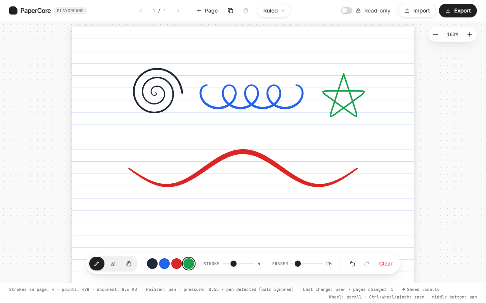
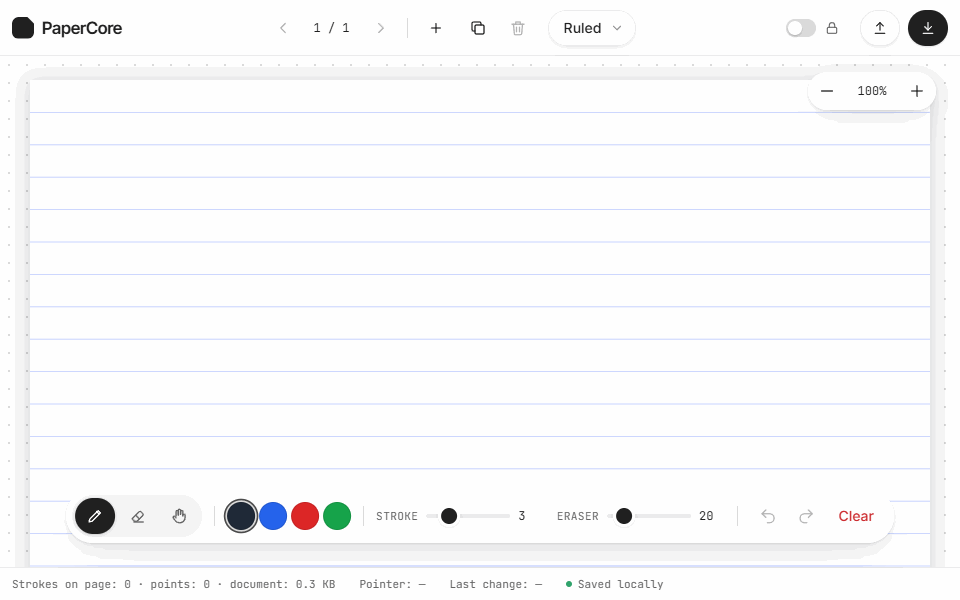
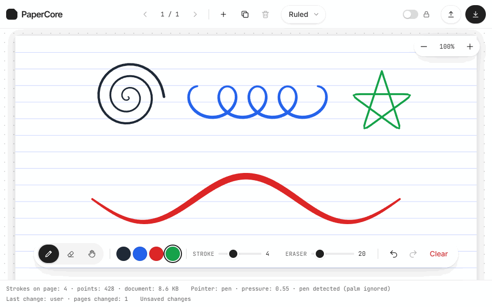
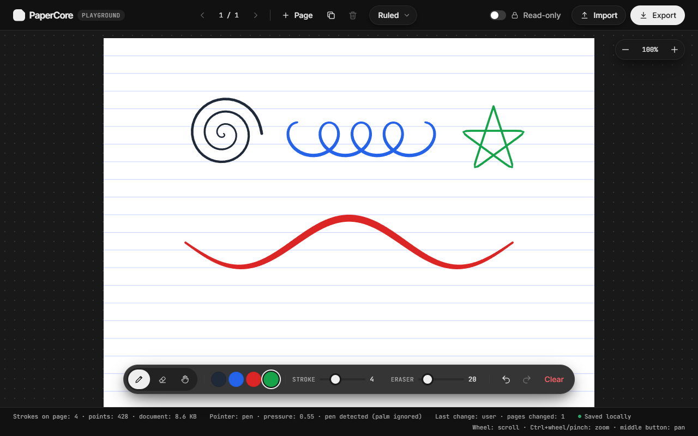
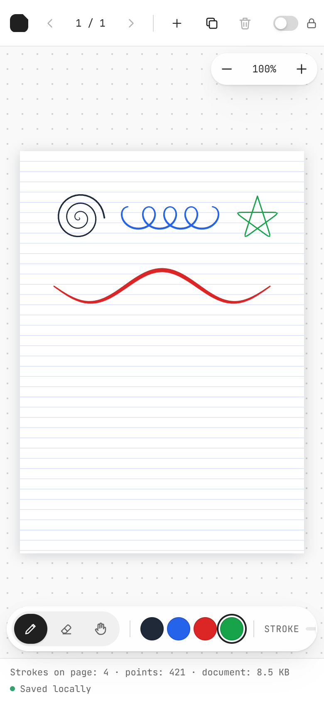
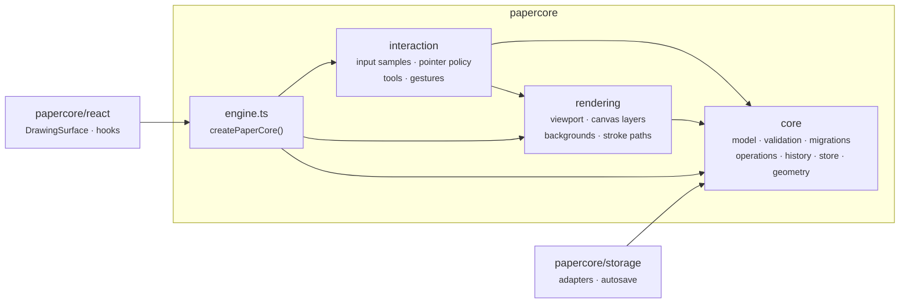
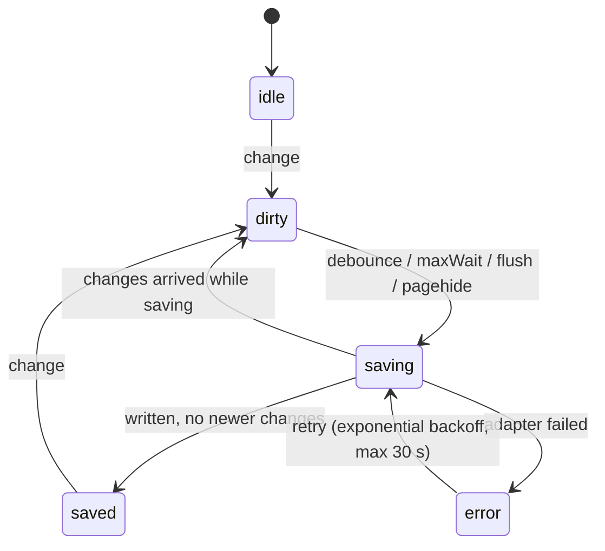

# PaperCore

[](https://github.com/GuiGarciaDev/PaperCore/actions/workflows/ci.yml)
[](https://guigarciadev.github.io/PaperCore/)
[](LICENSE)

**A small vector drawing engine for the web, built from scratch as an engineering and learning project.** Handwriting
with pressure-sensitive pens, multi-page documents with ruled or grid paper, an eraser that cuts
strokes instead of deleting them, per-page undo/redo, pluggable persistence with autosave and a React
binding, rendered with Canvas 2D and written in strict TypeScript with zero runtime dependencies.

**[▶ Try the live demo](https://guigarciadev.github.io/PaperCore/)** (works with a mouse, a finger or a stylus; your notebook is
saved automatically in your browser).

> **Not yet published to npm.** PaperCore is currently available for local development and testing.
> Installation through npm will be supported after the first public release. Until then, the
> `papercore` imports in the examples work when the package is linked locally, as described in
> [Using it from another project](#using-it-from-another-project).



```text
papercore           core engine (framework-agnostic, DOM only where it must be)
papercore/storage   storage adapters (IndexedDB, in-memory) and autosave
papercore/react     <DrawingSurface>, useDrawingEngine, useEngineState
```

> **Built with AI, engineered with intent.** PaperCore was developed through an AI-assisted
> engineering workflow: I defined the product, drove the architecture and every trade-off, and used
> an AI coding agent (Claude Code) to implement, test and verify each step under strict quality
> gates. See [How it was built with AI](#how-it-was-built-with-ai).
>
> 155 unit tests and 6 end-to-end tests in real Chrome · strict TypeScript · zero runtime
> dependencies · every technical decision documented.

---

## Contents

- [Demo](#demo)
- [Why I built it](#why-i-built-it)
- [Technical requirements](#technical-requirements)
- [How it was built with AI](#how-it-was-built-with-ai)
- [Quick start](#quick-start)
- [Usage](#usage)
- [Architecture](#architecture)
- [Technical decisions](#technical-decisions)
  - [Document model](#1-document-model)
  - [History as operations, one stack per page](#2-history-as-operations-one-stack-per-page)
  - [Stroke geometry](#3-stroke-geometry)
  - [Rendering and viewport](#4-rendering-and-viewport)
  - [Input, palm rejection and gestures](#5-input-palm-rejection-and-gestures)
  - [An eraser that cuts strokes](#6-an-eraser-that-cuts-strokes)
  - [Persistence and autosave](#7-persistence-and-autosave)
  - [React binding](#8-react-binding)
  - [Build and packaging](#9-build-and-packaging)
- [Testing strategy](#testing-strategy)
- [Bugs worth telling](#bugs-worth-telling)
- [Limits](#limits)
- [Scripts](#scripts)
- [Current limitations](#current-limitations)
- [Roadmap](#roadmap)

---

## Demo

| Pressure-sensitive pen                                      | An eraser that cuts strokes, undone step by step             |
| ----------------------------------------------------------- | ------------------------------------------------------------ |
|              |  |
| **Pages, backgrounds, zoom and pan**                        | **Dark theme**                                               |
|  |              |

<p align="center">
  
</p>

## Why I built it

Drawing apps feel simple from the outside, but a good one hides many interesting problems: pointer
events and palm rejection, turning noisy pressure samples into a smooth outline, keeping a canvas
sharp at any zoom without running out of memory, undo that does not copy the whole document, saving
without losing ink when a tab dies. PaperCore is my attempt to understand those problems by building
a small but complete engine from first principles, without a drawing library.

I set myself a few requirements to keep it honest:

- **Handwriting has to feel right** with a stylus (Apple Pencil, Surface pen), a finger and a mouse,
  with palm rejection, pressure and pinch zoom.
- **Documents stay vector.** Pages are data (strokes as points), never images, so they can be
  stored per page, migrated and exported.
- **The engine has no app logic.** Things like "lock the notebook when it is finished" belong to
  whoever uses it. The engine only offers the mechanism (`readOnly`).
- **Built like a real library**: strict types, a tested public API, documented decisions, and a
  playground that exercises every feature.

It is packaged as a standalone library, so it can evolve and be tested on its own.

## Technical requirements

A short summary of every requirement the engine was built against. The most important ones are
explained in depth under [Technical decisions](#technical-decisions).

**Scope and principles**

- A standalone package with a small public API. It knows nothing about users, backends or business
  rules.
- The document is structured vector data; the canvas is only a view, never the source of truth.
- Coordinates are always in logical page units, never physical pixels.
- Handwriting quality comes first. Nothing is implemented "just in case".

**Architecture**

- Layers: `core` → `rendering` → `interaction` → `engine`. `storage` depends only on `core`, and
  `react` only on the public API.
- The core has no DOM (checked by a dedicated tsconfig) and layer boundaries are enforced by ESLint.
- Three entry points: `papercore`, `papercore/storage` and `papercore/react`. React is an optional
  peer dependency.
- Safe to import during SSR: no module touches `window` or `document` when it loads.

**Document model**

- Multi-page documents. Each page has its own size and a background (blank, ruled or grid).
- Strokes are flat `[x, y, pressure]` arrays, quantized to 2 decimals when committed.
- Colors are `#rrggbb` only. IDs match `[A-Za-z0-9_-]{1,64}` and are unique per document, generated
  with `crypto.randomUUID` and a `crypto.getRandomValues` fallback for insecure contexts.
- Strict validation that returns a normalized copy, a versioned schema with pure `v → v+1`
  migrations, and documents from a newer version are rejected.
- Imports check the size before parsing. Errors are `PaperCoreError` instances with stable codes.

**History and events**

- Undo/redo stores operations (add, remove, replace) with their indices, not snapshots. One stack per
  page, with a configurable limit.
- A whole stroke is one operation, and so is a whole eraser gesture.
- Structural page actions (add, delete, duplicate, move, background) are not in history; clearing a
  page is.
- Immutable per-page updates and a `change` event with the reason and the affected pages. History is
  recorded before the event fires.
- Read-only mode is enforced by the store and can be toggled at runtime; navigation and zoom keep
  working.

**Rendering**

- Canvas 2D with three layers (background, strokes, live stroke), redrawn at most once per frame.
- The canvas is always viewport-sized, with the pixel ratio capped below the iOS Safari canvas limit.
- The viewport is `{ zoom, center }` in logical units: zoom 1 fits the page to the width, the page
  never leaves the screen and resizing keeps the same point centered.
- Cached `Path2D` per stroke, off-screen culling, and backgrounds drawn only where visible.

**Stroke**

- Raw points are stored and smoothed at render time, so the algorithm can improve without migrating
  documents.
- An in-house outline algorithm: pressure-driven radius, round caps and reinforced joints on tight
  curves.
- A stroke that reaches the point limit continues as a new stroke instead of dropping points.

**Input**

- Pointer Events with pointer capture, coalesced events and `touch-action: none`.
- Only one pointer draws at a time. Palm rejection is on by default (it can be turned off), and which
  pointer kinds may draw is configurable.
- Two-finger pinch zooms and pans; a second finger cancels a finger stroke.
- A cancelled pointer discards the stroke; losing capture or window focus commits it, so ink is never
  lost.
- Wheel pans, `Ctrl`/`⌘` + wheel zooms at the cursor, the middle button pans. Keyboard shortcuts are
  opt-in and only work while the surface has focus.

**Tools**

- Pen with color and width in logical units, so ink scales with zoom like paper.
- An eraser that cuts strokes, sized in screen pixels, with a live preview and one undo step per
  gesture. The eraser end of a digital pen erases with any tool.
- Pan tool, which is also what editing tools become in read-only mode.

**Persistence**

- Optional and outside the core, behind a pluggable adapter interface. IndexedDB and in-memory
  adapters are included.
- Autosave writes only dirty pages, debounced with a maximum wait, and never reports `saved` while
  changes are pending.
- Flushes when the tab is hidden or closed, retries failures with backoff, and validates stored data
  like any import.

**React**

- `<DrawingSurface>`, `useDrawingEngine` and `useEngineState`, safe under `StrictMode`.
- The toolbar is not part of the library; the playground is the reference implementation.

**Quality**

- Every limit is configurable (see [Limits](#limits)).
- Every stage had to pass both typechecks, lint, unit tests, the build and the end-to-end tests.

## How it was built with AI

This project is a deliberate exercise in **AI-assisted software engineering**: using an AI coding
agent as a force multiplier while keeping engineering judgment, architecture and quality firmly in
human hands. The AI wrote most of the code; the decisions about _what_ to build, _how_ it should be
structured and _whether it was good enough_ were mine.

**Division of work**

| I owned                                                                                | The AI agent (Claude Code) handled                       |
| -------------------------------------------------------------------------------------- | -------------------------------------------------------- |
| Learning goals, requirements and scope                                                 | Implementation of each stage from the agreed spec        |
| Architecture direction (separate repo, layering, pluggable storage, React as optional) | Writing the documentation and keeping it in sync         |
| Reviewing and approving every spec change and trade-off                                | Writing unit, integration and end-to-end tests           |
| Hands-on testing on real devices and reporting defects                                 | Root-cause analysis and fixes, with regression tests     |
| UI direction for the playground                                                        | Turning that direction into design tokens and components |

**The workflow**

1. **Spec first, then a critical review.** I wrote the functional and non-functional requirements and
   asked the AI to _find the flaws_ before writing any code. The review surfaced problems that would
   have been expensive later: no per-page history, colors open to injection in a future SVG export,
   iOS canvas memory limits, autosave race conditions, a duplicated React instance with local
   linking. Each fix became a documented decision.
2. **Small, verifiable stages.** The work was split into 7 stages (foundation → rendering → pen →
   eraser → pages → storage → React and distribution). Each stage had to pass the same gate before
   moving on: both typechecks (including a DOM-free core), lint with layer rules, all tests, the
   build and a manual check in the playground.
3. **Guardrails the AI cannot ignore.** Architectural rules are enforced by tooling (a DOM-free
   tsconfig for the core, ESLint import boundaries), so generated code that crosses a layer fails the
   build instead of slipping into review.
4. **Human testing on real hardware, AI-assisted debugging.** Defects such as the holes in thick
   curved strokes were found by using the notebook, then reproduced, measured (pixel sampling before
   and after) and locked down with regression tests. See [Bugs worth telling](#bugs-worth-telling).
5. **Decisions stay documented.** Every non-obvious choice is written down with its reasoning (see
   [Technical decisions](#technical-decisions)), so it survives beyond the conversation that produced
   it.

The takeaway: AI made it possible to deliver an engine of this scope (custom stroke geometry, a
cutting eraser, crash-consistent persistence, a StrictMode-safe React binding, 160+ tests) quickly
and alone, **without trading away rigor**. The rigor came from the process: clear specs, small
stages, automated gates and human review.

## Quick start

**Prerequisites:** Node.js 20 or later and npm. The end-to-end tests also need Google Chrome
installed, because Playwright drives the local Chrome instead of downloading its own browser.

```bash
git clone https://github.com/GuiGarciaDev/PaperCore.git
cd PaperCore
npm install
npm run dev          # playground at http://localhost:5173
```

The playground imports the source directly, so changes in `src/` show up immediately. It saves the
notebook to IndexedDB, so reloading the page reopens it. In the browser console, `paper` is the
engine instance (for example, `paper.getDocument()`).

**On a tablet or phone (same Wi-Fi network):**

```bash
npm run dev:lan      # HTTPS on the local network; open the "Network" URL Vite prints
```

The browser will warn about the self-signed certificate, which is expected in development. HTTPS is
required because some APIs (such as `crypto.randomUUID`) only exist in secure contexts.

## Usage

The examples below use the package's three entry points: `papercore`, `papercore/storage` and
`papercore/react`. Until the npm release, link the package locally first (see
[Using it from another project](#using-it-from-another-project)).

### Engine

```ts
import { createPaperCore } from "papercore";

const container = document.querySelector<HTMLElement>("#notebook")!;
const engine = createPaperCore(container, {
  // document: a PaperDocument to open; without it, a new document with one ruled page
  keyboardShortcuts: true, // Ctrl/⌘+Z, Ctrl/⌘+Shift+Z and Ctrl/⌘+Y, only while the surface has focus
});

engine.on("change", (change) => {
  // reason: "user" | "undo" | "redo" | "load"
  // changedPageIds / addedPageIds / deletedPageIds: the pages to persist
  console.log(change.reason, change.changedPageIds);
});

engine.setPenStyle({ color: "#2563eb", width: 4 });
engine.setTool("eraser");
engine.addPage();
engine.setReadOnly(true); // e.g. lock a finished notebook
const json = engine.exportJSON();
engine.destroy(); // idempotent; removes listeners, observers, frames and DOM
```

The container needs a size from CSS. The engine creates and manages its canvases inside it.

### Persistence

```ts
import { createPaperCore } from "papercore";
import { createAutosave, IndexedDbStorageAdapter } from "papercore/storage";

const container = document.querySelector<HTMLElement>("#notebook")!;
const storage = new IndexedDbStorageAdapter();
const [lastId] = await storage.list(); // ids of the stored documents
const saved = lastId ? await storage.load(lastId) : null; // null if nothing is stored

const engine = createPaperCore(container, { document: saved ?? undefined });
const autosave = createAutosave(engine, storage); // debounced, dirty pages only
if (!saved) await autosave.saveAll(); // a new document is only written once it changes, so save it now

autosave.on("state", ({ status }) => console.log(status)); // idle | dirty | saving | saved | error
await autosave.flush(); // e.g. before navigating away
```

### React

```tsx
import { useState } from "react";
import type { PaperCore } from "papercore";
import { DrawingSurface, useEngineState } from "papercore/react";

function Notebook() {
  const [engine, setEngine] = useState<PaperCore | null>(null);
  const state = useEngineState(engine);
  return (
    <>
      <button disabled={!state?.canUndo} onClick={() => engine?.undo()}>
        Undo
      </button>
      <DrawingSurface
        options={{ keyboardShortcuts: true }}
        onEngine={setEngine}
        style={{ height: "80vh" }} // the surface fills its parent by default; it needs a real height
      />
    </>
  );
}
```

React is an **optional** peer dependency: only `papercore/react` needs it. `useDrawingEngine(options)`
is also exported for apps that want to render their own container: it returns a callback `ref` and
the `engine`.

### Using it from another project

Until the npm release, clone this repository next to your app and point a `file:` dependency at it:

```jsonc
// your app's package.json
"dependencies": { "papercore": "file:../PaperCore" }
```

The consumer imports the compiled `dist/` folder, so run `npm run build` (or `npm run build:watch`
while you develop) in the PaperCore folder. If your app uses Vite and React, also set
`resolve.dedupe: ["react", "react-dom"]` in its Vite config: npm installs a `file:` dependency as a
symlink, so without dedupe the app can load two copies of React ("Invalid hook call").

## Architecture



What each layer does:

- **Core** (`src/core`): the framework-independent heart of the engine. The document model,
  validation, migrations and JSON serialization; the operations, per-page history and the store
  that applies them; and the pure geometry for stroke outlines and for the cutting eraser. It has no
  DOM access.
- **Rendering** (`src/rendering`): the viewport math (zoom, pan, screen ↔ logical coordinates), the
  three stacked canvases sized to the device pixel ratio, ruled and grid backgrounds, and turning
  strokes into cached `Path2D` objects. It redraws at most once per animation frame.
- **Interaction** (`src/interaction`): converts Pointer Events into normalized input samples,
  decides which pointer may draw (palm rejection), recognizes pinch and wheel gestures, and holds the
  pen, eraser and pan tools.
- **Engine** (`src/engine.ts`): `createPaperCore()` wires the layers together and owns the
  lifecycle: pages, tools, zoom, read-only mode, keyboard shortcuts, events and `destroy()`.
- **Storage** (`papercore/storage`): the `StorageAdapter` interface, IndexedDB and in-memory
  adapters, and the autosave. It splits a document into per-page records and reassembles it; the
  JSON format itself lives in the core.
- **React** (`papercore/react`): the optional `<DrawingSurface>` component and the
  `useDrawingEngine` and `useEngineState` hooks, built only on the public API.

Layer boundaries are **enforced by tooling, not by discipline**:

- `core` is compiled by a second tsconfig (`tsconfig.core.json`) **without the DOM lib**. Any
  `window`, `document` or `Path2D` in the core breaks `npm run typecheck`. As a result, the core
  (model, history, stroke geometry, eraser geometry) is tested in plain Node.
- ESLint `no-restricted-imports` rules forbid each layer from importing the layers above it. The
  React layer may only use the package's public API.
- The public API comes only from the entry points (`src/index.ts`, `src/storage/index.ts`,
  `src/react/index.ts`). Internal classes such as the store, renderer and pointer controller are not
  exported.

```text
src/core/          document model, validation, migrations, operations, history, store, geometry
src/rendering/     viewport math, canvas layers, backgrounds, stroke paths
src/interaction/   input normalization, pointer policy, pen / eraser / pan tools, pointer controller
src/storage/       storage adapters and autosave
src/react/         React component and hooks
src/engine.ts      wires everything into createPaperCore()
playground/        demo app (not published)
tests/             Vitest unit tests (engine and React in happy-dom)
e2e/               Playwright tests against the playground
```

## Technical decisions

The choices below are the ones where the obvious approach was not good enough. Each one explains
what was decided and why.

### 1. Document model

```ts
interface PaperDocument {
  id: string;
  schemaVersion: 1; // structural format version, NOT a persistence revision
  defaultPageSize: Size; // only used for new pages
  pages: PaperPage[]; // array order IS page order (no "page number" field)
}
interface PaperPage {
  id: string;
  size: Size; // per page: pages can have different proportions
  background: PageBackground; // blank | ruled | grid: configuration, never an image
  elements: PaperElement[]; // array order IS z-order
}
interface StrokeElement {
  id: string;
  type: "stroke";
  style: { color: `#${string}`; width: number }; // width in logical units: scales with zoom, like paper
  hasPressure: boolean;
  points: number[]; // flat [x, y, p, x, y, p, …], stride 3, 2 decimals
}
type PaperElement = StrokeElement; // discriminated union: text, shapes and images slot in here
```

- **Flat point arrays.** `[x, y, p, …]` uses about 3× less memory than `{x, y, pressure}` objects and
  serializes smaller. The stride is fixed (pressure `0.5` when the device has none) to keep reads
  simple, at the cost of about 33% more data for mouse strokes.
- **Quantized at commit time** to 2 decimals, so the in-memory document is byte-identical to the
  serialized one and the JSON round-trip is exact.
- **Colors are `#rrggbb` only.** A future SVG export would interpolate colors into attributes, and
  accepting any string would be an injection vector. Opaque ink also simplifies rendering.
- **Strict, hand-written validation** returns a _normalized copy_ built only from known fields.
  Unknown keys are rejected, nothing imported is used by reference, and `__proto__` from JSON cannot
  leak in. Zod was not justified for a single element type.
- **Migrations are pure `v → v+1` functions.** A document from a _newer_ schema is rejected with
  `UNSUPPORTED_VERSION`, never silently accepted.
- Errors are `PaperCoreError` instances with a stable `code` (`INVALID_DOCUMENT`, `READ_ONLY`,
  `LIMIT_EXCEEDED`, `STORAGE_CORRUPTED`, …), so apps can branch on them.

### 2. History as operations, one stack per page

```ts
type ElementOperation =
  | { type: "ADD_ELEMENTS"; pageId; added: { index; element }[] }
  | { type: "REMOVE_ELEMENTS"; pageId; removed: { index; element }[] }
  | { type: "REPLACE_ELEMENTS"; pageId; removed: { index; element }[]; added: { index; element }[] };
```

- History stores **operations, not snapshots**. Elements are immutable and shared between the
  document and the history, so memory grows with what changed, not with document size.
- **Indices are stored**: `removed` uses pre-state indices and `added` uses post-state indices.
  Apply = remove in descending order, then insert in ascending order. Invert = swap the two lists.
  Undo therefore puts every element back **in its original z-order layer**.
- **One undo stack per page.** Undo only affects the page you are looking at, as in a real notebook.
  A global stack would make undo jump between pages.
- Structural page operations (add, delete, duplicate, move, change background) are not in history
  for now. "Clear page" is (it is a `REMOVE_ELEMENTS`).
- The `PaperStore` uses **immutable per-page updates**: each change creates a new page object and a
  new document object while sharing untouched pages. Snapshots are cheap and safe to hand to
  `useSyncExternalStore`.

### 3. Stroke geometry

The stroke outline is an in-house pure function (`core/geometry/strokeOutline.ts`) instead of a
library such as `perfect-freehand`. It sits behind one signature, so it can be swapped without
touching the renderer or the documents.

1. Drop consecutive duplicate points.
2. Smooth positions and radii with a `[¼, ½, ¼]` kernel in two passes, keeping the endpoints.
3. Compute normals from the central tangent and offset each point by ±radius, with
   `radius = width/2 × (hasPressure ? 0.35 + 1.3·p : 1)`.
4. Build one polygon: left side, round end cap, right side reversed, round start cap.
5. Add **joint circles** where the path turns more than ~75° **or** where the local radius of
   curvature (segment length ÷ turn angle) is smaller than the stroke radius. There, the inner side
   of the outline folds over itself.

**Raw input points are stored and smoothing happens at render time.** The algorithm can improve
without migrating documents, at the cost of old documents possibly changing appearance slightly.
During capture, points closer than ~0.75 screen px to the previous one are dropped.

### 4. Rendering and viewport

- **Three canvas layers**: background, committed strokes and live stroke. While writing, only the
  live layer is redrawn. Redraws are batched with `requestAnimationFrame`, at most one per frame.
- **The canvas is always viewport-sized** (container × DPR), never page × zoom, so zooming in does
  not cost memory. The effective DPR is capped so the canvas stays under 16,777,216 pixels: above
  that limit iOS Safari silently renders a blank canvas.
- Viewport state is `{ zoom, centerX, centerY }` with the center in **logical** coordinates. The
  transform is derived (`scale = fitScale × zoom`, `offset = containerCenter − center × scale`), so
  resizing the container keeps the same point centered with no extra code. All screen ↔ logical
  conversions live in one pure, tested module; tools never compute transforms themselves.
- `Path2D` objects are cached per element in a `WeakMap` (safe because elements are immutable), and
  strokes outside the visible rect are culled by bounding box. Ruled and grid lines are drawn only
  for the visible area, never thinner than one physical pixel.

### 5. Input, palm rejection and gestures

- DOM pointer events are normalized into a pure
  `InputSample { x, y, pressure, hasPressure, kind, time }`. Tools only consume samples, so they are
  unit-tested without a browser, including simulated pen pressure, which Playwright cannot reproduce
  well.
- Pointer Events with `setPointerCapture`, `getCoalescedEvents()` when available (full pen
  resolution at high report rates) and `touch-action: none`.
- **Only one pointer draws at a time.** **Palm rejection is on by default**: once a `pen` pointer has
  been seen, touch switches to pan and pinch. Both are configurable through `options.input`
  (`palmRejection` and `drawWith`).
- Two-finger **pinch** zooms and pans. A second finger during a finger stroke cancels that stroke.
- `pointercancel` **discards** the stroke, because the browser took over the gesture.
  `lostpointercapture` without `pointerup`, and window `blur`, **commit** it, so ink is never lost.
- Keyboard shortcuts are **opt-in** and scoped to the focused surface. The engine never listens on
  `window`, so it cannot fight the host app's inputs.

### 6. An eraser that cuts strokes

Most simple drawing apps delete the whole stroke on contact. PaperCore removes **only the part that
was touched** and keeps the document vector.

- Each pointer move becomes a **sweep**: a capsule (segment plus radius) from the previous to the
  current position, so fast moves do not skip strokes.
- A point is erased when `distance(point, sweep) ≤ eraserRadius + strokeRadius(point)`, so the real
  stroke width, pressure included, counts in the collision.
- **Local subdivision:** stroke segments longer than `radius/2` and near the sweep are subdivided
  before the test. Without it, a quick straight line (2 points) would vanish entirely when touched in
  the middle. Only nearby segments are subdivided, so strokes do not bloat.
- Surviving runs of points become new strokes with new ids, the same style, and the original pressure
  at the cut ends, so cuts do not taper. Pieces under 2 points are dropped, and pieces over
  `maxPointsPerStroke` are split.
- An `EraseSession` applies sweeps to a **working copy** of the page during the gesture, which the
  renderer shows as a preview. The store does not change. On release it diffs the original against
  the copy and emits **one** `REPLACE_ELEMENTS` for the whole gesture. Pieces created and erased
  within the same gesture never show up in it. One undo restores everything in its original layer.
- Eraser size is in **screen pixels** (logical radius = `size / 2 / scale`), so it feels the same at
  any zoom. The eraser end of digital pens (`pointerType: "pen"`, `button: 5`) erases without
  switching tools.

### 7. Persistence and autosave

```ts
interface StorageAdapter {
  load(documentId: string): Promise<PaperDocument | null>;
  savePages(documentId: string, pages: PaperPage[], meta: DocumentMeta): Promise<void>; // dirty pages only
  deletePages(documentId: string, pageIds: string[]): Promise<void>;
  deleteDocument(documentId: string): Promise<void>;
  list(): Promise<string[]>;
}
```

- Persistence lives in its own subpath and depends only on the core. It saves **dirty pages, not the
  whole document**, which keeps writes small and maps naturally onto per-page sync. The app can plug in its own
  adapter, for example one that writes locally and queues for the server.
- **Crash consistency.** `meta.pageIds` is the source of truth for which pages exist and in what
  order. The IndexedDB adapter writes pages **and** meta in a single transaction. Deletions happen
  afterwards, so if the tab dies in between, orphan pages are simply ignored on load. A page listed
  but missing raises `STORAGE_CORRUPTED`.
- **Stored data is untrusted data.** Loading runs the same migration and strict validation as a
  JSON import.

The autosave is a small state machine:



- **The race condition is handled with generations.** Every change bumps a counter. When a save
  finishes, if the generation moved on while it was writing, the state goes back to `dirty` and
  another save is scheduled. The UI **never shows `saved` while changes are pending**.
- Debounce (800 ms) with `maxWait` (5 s), so continuous writing still gets saved.
- `flush()` is public (for example, the app flushes before navigating away) and also runs on
  `visibilitychange → hidden` and `pagehide`, the last reliable moments on mobile.
- `reason: "load"` does not mark the document dirty. If a load replaces a document that still has
  pending changes, the pending batch is saved first, using the old document's immutable snapshot.
- On failure, batches are kept and retried. Nothing is dropped.
- `saved` means "written to the adapter", **not** "synced with a server". Sync status belongs to
  the app.
- IndexedDB is opened lazily (safe to import during SSR) and releases its connection on
  `versionchange`, so another tab can upgrade the schema.

### 8. React binding

- `<DrawingSurface>`, `useDrawingEngine` (callback ref plus engine lifecycle) and `useEngineState`,
  which is built on `useSyncExternalStore`. `getState()` returns the same object until something
  changes, which is exactly what the hook requires.
- **StrictMode-safe.** React mounts, unmounts and remounts effects in development. `destroy()` is
  idempotent and removes every listener, observer, animation frame and timer, so the discarded
  instance leaves nothing behind. A test asserts there is exactly one live engine and one set of
  canvases afterwards.
- Options are read on mount only, like an input's `defaultValue`. To change the document later, call
  `engine.loadDocument`.
- The toolbar is **not** part of the library. Apps use their own design system; the playground is
  the reference implementation.

### 9. Build and packaging

- Built with plain **`tsc`**: ESM, one file per module, `.d.ts`, declaration maps and source maps. No
  bundling, because consumers already have a bundler and separate modules tree-shake better. Vite is
  only used for the playground.
- Internal imports use `.js` extensions (`moduleResolution: NodeNext`), so `dist/` works both in
  bundlers and in Node.
- `exports` exposes `.`, `./storage` and `./react`. `sideEffects: false`. No module touches `window`
  or `document` at import time, so all three subpaths can be imported in Node or during SSR (checked
  by importing them from the built package in plain Node).

## Testing strategy

The suite has three levels: **unit tests** for pure modules, **integration tests** that run several
layers together in a simulated DOM, and **end-to-end tests** in a real browser.

| Level       | Layer       | Tool                         | What it covers                                                                                                                                          |
| ----------- | ----------- | ---------------------------- | ------------------------------------------------------------------------------------------------------------------------------------------------------- |
| Unit        | Core        | Vitest, plain Node           | Validation, migrations, serialization round-trip, operation apply/invert, per-page history, store events, stroke geometry, eraser geometry and sessions |
| Unit        | Rendering   | Vitest                       | Viewport math (screen ↔ logical, clamping, zoom around a point); fill strategy with a recording fake `Path2D`                                           |
| Unit        | Interaction | Vitest                       | Pen and eraser tools driven by synthetic `InputSample`s, including pressure and cancellation                                                            |
| Integration | Engine      | Vitest + happy-dom           | Pages, active-page rules, read-only mode, change events, idempotent destroy (canvas is stubbed: state, not pixels)                                      |
| Integration | Storage     | Vitest + fake-indexeddb      | Both adapters against the same contract suite; autosave with fake timers (debounce, maxWait, races, retries, flush, page hide)                          |
| Integration | React       | Vitest + happy-dom           | StrictMode lifecycle, unmount cleanup, `useEngineState` re-renders                                                                                      |
| End-to-end  | Playground  | Playwright, installed Chrome | Draw/undo/redo, eraser cutting, persistence across reload, pages with confirmation dialog, read-only, a pixel-level regression check for stroke holes   |

`npm test` runs the unit and integration tests (155) and `npm run test:e2e` the end-to-end tests (6;
it starts the playground on its own). `npm run check` runs both typechecks (full project and DOM-free
core), lint, the Vitest suite and the build. CI runs `npm run check` on every push and pull request.

## Bugs worth telling

**Holes in thick curved strokes.** Thick strokes showed white circular holes along tight curves.
The joint circles that cover the fold on the inner side of a curve were added to the same `Path2D`
as the outline polygon, and Canvas fills with the `nonzero` winding rule. Wherever a circle's winding
direction was opposite to the outline's at that spot, the two cancelled out and the "reinforcement"
became a hole. The fix fills the outline and the joints as **separate paths** (ink is opaque, so
painting twice changes nothing). It is covered by a unit test that asserts the outline path contains
no arcs, and by an end-to-end test that samples pixels along a thick curve.

**The undo button that lagged one step behind.** The store emitted `change` _before_ recording the
operation in history, so anything that reacted to the event (the engine's state, and with it the
Undo button) saw `canUndo === false` right after the first action. History is now recorded between
validation and emission, with a regression test that checks `canUndo` and `canRedo` from inside the
listener.

## Limits

All limits live in `core/config.ts` and can be overridden through `options.limits`.

| Limit                                                       | Default                 |
| ----------------------------------------------------------- | ----------------------- |
| Pages per document                                          | 200                     |
| Elements per page                                           | 5,000                   |
| Points per stroke (longer strokes continue as a new stroke) | 4,000                   |
| Import size                                                 | 20 MiB of JSON text     |
| History operations per page                                 | 200                     |
| Zoom                                                        | 0.25× to 8×             |
| Pen width                                                   | 0.5 to 40 logical units |
| Eraser size                                                 | 4 to 120 screen px      |
| Page size                                                   | 100 to 10,000 units     |
| Background line spacing                                     | 4 to 400 units          |
| Background line width                                       | 0.25 to 10 units        |

## Scripts

| Script                | What it does                                                         |
| --------------------- | -------------------------------------------------------------------- |
| `npm run dev`         | Playground with hot reload                                           |
| `npm run dev:lan`     | Playground over HTTPS on the local network (tablet testing)          |
| `npm test`            | Unit tests (Vitest)                                                  |
| `npm run test:e2e`    | End-to-end tests (Playwright, uses the installed Chrome)             |
| `npm run typecheck`   | Types for the whole project **and** for the core without the DOM lib |
| `npm run lint`        | ESLint, including the layer-boundary rules                           |
| `npm run build`       | Emits `dist/` (ESM + `.d.ts`)                                        |
| `npm run build:watch` | Continuous build, for local linking                                  |
| `npm run check`       | All of the above except e2e, in sequence                             |

## Current limitations

What PaperCore does **not** do today:

- **Strokes are the only element type.** There is no text, shapes, images, selection or lasso.
- **Ink is opaque.** Colors are `#rrggbb` only, so there is no highlighter or transparency.
- **Export is JSON only.** There is no PNG, SVG or PDF export.
- **History lives in memory.** Undo/redo is lost on reload, and page actions (add, delete,
  duplicate, move, background) cannot be undone.
- **No page thumbnails or drag-to-reorder UI.** The engine has `movePage()`, but the playground has
  no UI for it.
- **Single user.** There is no real-time collaboration or server sync; `saved` means written to the
  storage adapter.
- **Browser coverage.** Automated end-to-end tests run only in Chrome. Other browsers, and real pen
  pressure on tablets, are checked by hand.
- **Not on npm yet** (see the notice at the top).

## Roadmap

The model already leaves room for these next steps (discriminated element union,
indexed operations, schema migrations):

- Page thumbnails and page reordering UI
- Export to PNG, SVG and PDF
- Selection, lasso, text, shapes and images
- Highlighter (translucent ink needs a different fill strategy than opaque strokes)
- Spatial index for very dense pages; tiled or bitmap-cached rendering if profiling asks for it
- Publishing to npm

## License

[MIT](LICENSE)
