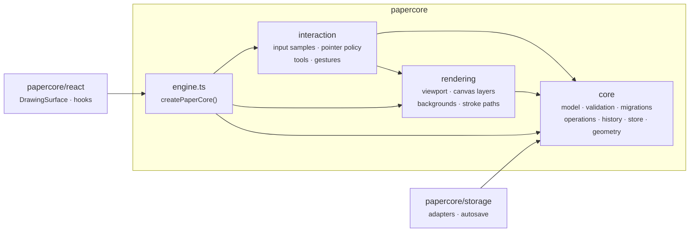
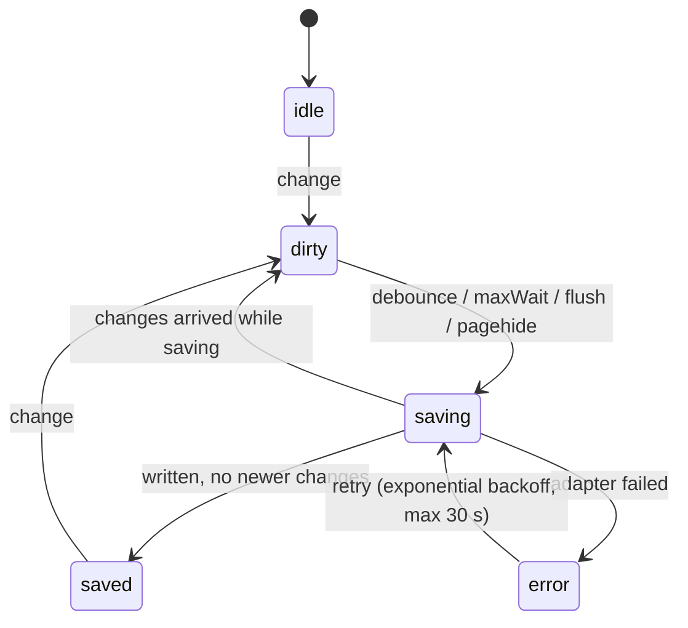

# PaperCore

**A vector drawing engine for digital notebooks on the web.** Handwriting with pressure-sensitive pens,
multi-page documents with ruled or grid paper, an eraser that cuts strokes instead of deleting them,
per-page undo/redo, pluggable persistence with autosave and a React binding, rendered with Canvas 2D
and written in strict TypeScript with zero runtime dependencies.

```
papercore           core engine (framework-agnostic, DOM only where it must be)
papercore/storage   storage adapters (IndexedDB, in-memory) and autosave
papercore/react     <DrawingSurface>, useDrawingEngine, useEngineState
```

> **Status:** MVP complete (all 7 planned stages). 155 unit tests and 6 end-to-end tests run in
> real Chrome. Not yet published to npm: it is consumed locally by a study platform (exam questions
> plus a digital notebook) that is being built on top of it.

---

## Contents

- [Why it exists](#why-it-exists)
- [Quick start](#quick-start)
- [Usage](#usage)
- [Architecture](#architecture)
- [Technical decisions](#technical-decisions)
  - [Document model](#1-document-model)
  - [History as operations, one stack per page](#2-history-as-operations-one-stack-per-page)
  - [Stroke geometry](#3-stroke-geometry)
  - [Rendering and viewport](#4-rendering-and-viewport)
  - [Input, palm rejection and gestures](#5-input-palm-rejection-and-gestures)
  - [An eraser that cuts strokes](#6-an-eraser-that-cuts-strokes)
  - [Persistence and autosave](#7-persistence-and-autosave)
  - [React binding](#8-react-binding)
  - [Build and packaging](#9-build-and-packaging)
- [Testing strategy](#testing-strategy)
- [Bugs worth telling](#bugs-worth-telling)
- [Limits](#limits)
- [Scripts](#scripts)
- [Roadmap](#roadmap)

---

## Why it exists

PaperCore is the drawing layer of a study platform where students solve exam questions by hand, the
way they would on paper. That use case drives a few hard requirements:

- **Handwriting has to feel right** on an iPad with Apple Pencil, a Surface pen and a mouse, with
  palm rejection, pressure and pinch zoom.
- **Documents must stay vector.** Pages are data (strokes as points), never images, so they can be
  stored per page, synced, migrated and later exported.
- **No business rules inside the engine.** "Lock the notebook after the answer is submitted" belongs
  to the app. The engine only offers the mechanism (`readOnly`).

It lives in its own repository so it can evolve, be tested and be shown on its own
([ADR-0001](docs/adr/0001-repositorio-separado.md)).

## Quick start

```bash
npm install
npm run dev          # playground at http://localhost:5173
```

The playground imports the source directly, so changes in `src/` show up immediately. It saves the
notebook to IndexedDB, so reloading the page reopens it. In the browser console, `paper` is the
engine instance (for example, `paper.getDocument()`).

**On a tablet or phone (same Wi-Fi network):**

```bash
npm run dev:lan      # HTTPS on the local network; open the "Network" URL Vite prints
```

The browser will warn about the self-signed certificate, which is expected in development. HTTPS is
required because some APIs (such as `crypto.randomUUID`) only exist in secure contexts.

## Usage

### Engine

```ts
import { createPaperCore } from "papercore";

const engine = createPaperCore(document.querySelector("#notebook")!, {
  document: savedDocument, // optional; a new ruled page otherwise
  keyboardShortcuts: true, // Ctrl/⌘+Z only while the surface has focus
});

engine.on("change", (change) => {
  // change.reason: "user" | "undo" | "redo" | "load"
  // change.changedPageIds / addedPageIds / deletedPageIds: persist only those
});

engine.setPenStyle({ color: "#2563eb", width: 4 });
engine.setTool("eraser");
engine.addPage();
engine.setReadOnly(true); // e.g. after the answer was submitted
const json = engine.exportJSON();
engine.destroy(); // idempotent; removes listeners, observers, frames and DOM
```

The container needs a size from CSS. The engine creates and manages its canvases inside it.

### Persistence

```ts
import { createAutosave, IndexedDbStorageAdapter } from "papercore/storage";

const storage = new IndexedDbStorageAdapter();
const saved = await storage.load(documentId); // null if it does not exist
const engine = createPaperCore(container, { document: saved ?? undefined });
const autosave = createAutosave(engine, storage); // debounced, dirty pages only
if (!saved) await autosave.saveAll(); // first save

autosave.on("state", ({ status }) => showIndicator(status)); // idle | dirty | saving | saved | error
await autosave.flush(); // before submitting an answer, for example
```

### React

```tsx
import { DrawingSurface, useEngineState } from "papercore/react";

function Notebook() {
  const [engine, setEngine] = useState<PaperCore | null>(null);
  const state = useEngineState(engine);
  return (
    <>
      <button disabled={!state?.canUndo} onClick={() => engine?.undo()}>
        Undo
      </button>
      <DrawingSurface options={{ keyboardShortcuts: true }} onEngine={setEngine} />
    </>
  );
}
```

React is an **optional** peer dependency: only `papercore/react` needs it.

### Consuming it locally from another project

```jsonc
// consumer package.json
"dependencies": { "papercore": "file:../PaperCore" }
```

Run `npm run build:watch` here. In the consumer's Vite config, set
`resolve.dedupe: ["react", "react-dom"]`. npm installs a `file:` dependency as a symlink, so without
dedupe the app can load two copies of React ("Invalid hook call").

## Architecture



Layer boundaries are **enforced by tooling, not by discipline**
([ADR-0002](docs/adr/0002-camadas-e-fronteiras.md)):

- `core` is compiled by a second tsconfig (`tsconfig.core.json`) **without the DOM lib**. Any
  `window`, `document` or `Path2D` in the core breaks `npm run typecheck`. As a result, the core
  (model, history, stroke geometry, eraser geometry) is tested in plain Node.
- ESLint `no-restricted-imports` rules forbid each layer from importing the layers above it. The
  React layer may only use the package's public API.
- The public API comes only from the entry points (`src/index.ts`, `src/storage/index.ts`,
  `src/react/index.ts`). Internal classes such as the store, renderer and pointer controller are not
  exported.

```
src/core/          document model, validation, migrations, operations, history, store, geometry
src/rendering/     viewport math, canvas layers, backgrounds, stroke paths
src/interaction/   input normalization, pointer policy, pen / eraser / pan tools, pointer controller
src/storage/       storage adapters and autosave
src/react/         React component and hooks
src/engine.ts      wires everything into createPaperCore()
playground/        demo app (not published)
tests/             Vitest unit tests (engine and React in happy-dom)
e2e/               Playwright tests against the playground
docs/              revised spec and ADRs (in Portuguese)
```

## Technical decisions

Every non-obvious decision is recorded as an ADR in [`docs/adr`](docs/adr), and the full revised
spec is in [`docs/SPEC.md`](docs/SPEC.md). Both are written in Portuguese; the summaries below
cover the reasoning.

### 1. Document model

([ADR-0003](docs/adr/0003-modelo-do-documento.md))

```ts
interface PaperDocument {
  id: string;
  schemaVersion: 1; // structural format version, NOT a persistence revision
  defaultPageSize: Size; // only used for new pages
  pages: PaperPage[]; // array order IS page order (no "page number" field)
}
interface PaperPage {
  id: string;
  size: Size; // per page: pages can have different proportions
  background: PageBackground; // blank | ruled | grid: configuration, never an image
  elements: PaperElement[]; // array order IS z-order
}
interface StrokeElement {
  id: string;
  type: "stroke";
  style: { color: `#${string}`; width: number }; // width in logical units: scales with zoom, like paper
  hasPressure: boolean;
  points: number[]; // flat [x, y, p, x, y, p, …], stride 3, 2 decimals
}
type PaperElement = StrokeElement; // discriminated union: text, shapes and images slot in here
```

- **Flat point arrays.** `[x, y, p, …]` uses about 3× less memory than `{x, y, pressure}` objects and
  serializes smaller. The stride is fixed (pressure `0.5` when the device has none) to keep reads
  simple, at the cost of about 33% more data for mouse strokes.
- **Quantized at commit time** to 2 decimals, so the in-memory document is byte-identical to the
  serialized one and the JSON round-trip is exact.
- **Colors are `#rrggbb` only.** A future SVG export would interpolate colors into attributes, and
  accepting any string would be an injection vector. Opaque ink also simplifies rendering.
- **Strict, hand-written validation** returns a _normalized copy_ built only from known fields.
  Unknown keys are rejected, nothing imported is used by reference, and `__proto__` from JSON cannot
  leak in. Zod was not justified for a single element type.
- **Migrations are pure `v → v+1` functions.** A document from a _newer_ schema is rejected with
  `UNSUPPORTED_VERSION`, never silently accepted.
- Errors are `PaperCoreError` instances with a stable `code` (`INVALID_DOCUMENT`, `READ_ONLY`,
  `LIMIT_EXCEEDED`, `STORAGE_CORRUPTED`, …), so apps can branch on them.

### 2. History as operations, one stack per page

([ADR-0004](docs/adr/0004-historico-por-operacoes.md))

```ts
type ElementOperation =
  | { type: "ADD_ELEMENTS"; pageId; added: { index; element }[] }
  | { type: "REMOVE_ELEMENTS"; pageId; removed: { index; element }[] }
  | { type: "REPLACE_ELEMENTS"; pageId; removed: { index; element }[]; added: { index; element }[] };
```

- History stores **operations, not snapshots**. Elements are immutable and shared between the
  document and the history, so memory grows with what changed, not with document size.
- **Indices are stored**: `removed` uses pre-state indices and `added` uses post-state indices.
  Apply = remove in descending order, then insert in ascending order. Invert = swap the two lists.
  Undo therefore puts every element back **in its original z-order layer**.
- **One undo stack per page.** Undo only affects the page you are looking at, as in a real notebook.
  A global stack would make undo jump between pages.
- Structural page operations (add, delete, duplicate, move, change background) are not in history
  for the MVP. "Clear page" is (it is a `REMOVE_ELEMENTS`).
- The `PaperStore` uses **immutable per-page updates**: each change creates a new page object and a
  new document object while sharing untouched pages. Snapshots are cheap and safe to hand to
  `useSyncExternalStore`.

### 3. Stroke geometry

([ADR-0005](docs/adr/0005-geometria-do-traco.md))

The stroke outline is an in-house pure function (`core/geometry/strokeOutline.ts`) instead of a
library such as `perfect-freehand`. It sits behind one signature, so it can be swapped without
touching the renderer or the documents.

1. Drop consecutive duplicate points.
2. Smooth positions and radii with a `[¼, ½, ¼]` kernel in two passes, keeping the endpoints.
3. Compute normals from the central tangent and offset each point by ±radius, with
   `radius = width/2 × (hasPressure ? 0.35 + 1.3·p : 1)`.
4. Build one polygon: left side, round end cap, right side reversed, round start cap.
5. Add **joint circles** where the path turns more than ~75° **or** where the local radius of
   curvature (segment length ÷ turn angle) is smaller than the stroke radius. There, the inner side
   of the outline folds over itself.

**Raw input points are stored and smoothing happens at render time.** The algorithm can improve
without migrating documents, at the cost of old documents possibly changing appearance slightly.
During capture, points closer than ~0.75 screen px to the previous one are dropped.

### 4. Rendering and viewport

([ADR-0006](docs/adr/0006-viewport-e-canvas.md))

- **Three canvas layers**: background, committed strokes and live stroke. While writing, only the
  live layer is redrawn. Redraws are batched with `requestAnimationFrame`, at most one per frame.
- **The canvas is always viewport-sized** (container × DPR), never page × zoom, so zooming in does
  not cost memory. The effective DPR is capped so the canvas stays under 16,777,216 pixels: above
  that limit iOS Safari silently renders a blank canvas.
- Viewport state is `{ zoom, centerX, centerY }` with the center in **logical** coordinates. The
  transform is derived (`scale = fitScale × zoom`, `offset = containerCenter − center × scale`), so
  resizing the container keeps the same point centered with no extra code. All screen ↔ logical
  conversions live in one pure, tested module; tools never compute transforms themselves.
- `Path2D` objects are cached per element in a `WeakMap` (safe because elements are immutable), and
  strokes outside the visible rect are culled by bounding box. Ruled and grid lines are drawn only
  for the visible area, never thinner than one physical pixel.

### 5. Input, palm rejection and gestures

([ADR-0007](docs/adr/0007-entrada-e-gestos.md))

- DOM pointer events are normalized into a pure `InputSample { x, y, pressure, hasPressure, kind,
time }`. Tools only consume samples, so they are unit-tested without a browser, including
  simulated pen pressure, which Playwright cannot reproduce well.
- Pointer Events with `setPointerCapture`, `getCoalescedEvents()` when available (full pen
  resolution at high report rates) and `touch-action: none`.
- **Only one pointer draws at a time.** **Palm rejection is on by default**: once a `pen` pointer has
  been seen, touch switches to pan and pinch. Which pointer kinds may draw is configurable
  (`drawWith`).
- Two-finger **pinch** zooms and pans. A second finger during a finger stroke cancels that stroke.
- `pointercancel` **discards** the stroke, because the browser took over the gesture.
  `lostpointercapture` without `pointerup`, and window `blur`, **commit** it, so ink is never lost.
- Keyboard shortcuts are **opt-in** and scoped to the focused surface. The engine never listens on
  `window`, so it cannot fight the host app's inputs.

### 6. An eraser that cuts strokes

([ADR-0010](docs/adr/0010-borracha-que-corta.md))

Most simple drawing apps delete the whole stroke on contact. PaperCore removes **only the part that
was touched** and keeps the document vector.

- Each pointer move becomes a **sweep**: a capsule (segment plus radius) from the previous to the
  current position, so fast moves do not skip strokes.
- A point is erased when `distance(point, sweep) ≤ eraserRadius + strokeRadius(point)`, so the real
  stroke width, pressure included, counts in the collision.
- **Local subdivision:** stroke segments longer than `radius/2` and near the sweep are subdivided
  before the test. Without it, a quick straight line (2 points) would vanish entirely when touched in
  the middle. Only nearby segments are subdivided, so strokes do not bloat.
- Surviving runs of points become new strokes with new ids, the same style, and the original pressure
  at the cut ends, so cuts do not taper. Pieces under 2 points are dropped, and pieces over
  `maxPointsPerStroke` are split.
- An `EraseSession` applies sweeps to a **working copy** of the page during the gesture, which the
  renderer shows as a preview. The store does not change. On release it diffs the original against
  the copy and emits **one** `REPLACE_ELEMENTS` for the whole gesture. Pieces created and erased
  within the same gesture never show up in it. One undo restores everything in its original layer.
- Eraser size is in **screen pixels** (logical radius = `size / 2 / scale`), so it feels the same at
  any zoom. The back end of digital pens (`pointerType: "pen"`, `button: 5`) erases without switching
  tools.

### 7. Persistence and autosave

([ADR-0008](docs/adr/0008-persistencia-plugavel.md))

```ts
interface StorageAdapter {
  load(documentId: string): Promise<PaperDocument | null>;
  savePages(documentId: string, pages: PaperPage[], meta: DocumentMeta): Promise<void>; // dirty pages only
  deletePages(documentId: string, pageIds: string[]): Promise<void>;
  deleteDocument(documentId: string): Promise<void>;
  list(): Promise<string[]>;
}
```

- Persistence lives in its own subpath and depends only on the core. It saves **dirty pages, not the
  whole document**, which matches the study platform's per-page sync. The app can plug in its own
  adapter, for example one that writes locally and queues for the server.
- **Crash consistency.** `meta.pageIds` is the source of truth for which pages exist and in what
  order. The IndexedDB adapter writes pages **and** meta in a single transaction. Deletions happen
  afterwards, so if the tab dies in between, orphan pages are simply ignored on load. A page listed
  but missing raises `STORAGE_CORRUPTED`.
- **Stored data is untrusted data.** Loading runs the same migration and strict validation as a
  JSON import.

The autosave is a small state machine:



- **The race condition is handled with generations.** Every change bumps a counter. When a save
  finishes, if the generation moved on while it was writing, the state goes back to `dirty` and
  another save is scheduled. The UI **never shows `saved` while changes are pending**.
- Debounce (800 ms) with `maxWait` (5 s), so continuous writing still gets saved.
- `flush()` is public (the app flushes before submitting an answer) and also runs on
  `visibilitychange → hidden` and `pagehide`, the last reliable moments on mobile.
- `reason: "load"` does not mark the document dirty. If a load replaces a document that still has
  pending changes, the pending batch is saved first, using the old document's immutable snapshot.
- On failure, batches are kept and retried. Nothing is dropped.
- `saved` means "written to the adapter", **not** "synced with a server". Sync status belongs to
  the app.
- IndexedDB is opened lazily (safe to import during SSR) and releases its connection on
  `versionchange`, so another tab can upgrade the schema.

### 8. React binding

- `<DrawingSurface>`, `useDrawingEngine` (callback ref plus engine lifecycle) and `useEngineState`,
  which is built on `useSyncExternalStore`. `getState()` returns the same object until something
  changes, which is exactly what the hook requires.
- **StrictMode-safe.** React mounts, unmounts and remounts effects in development. `destroy()` is
  idempotent and removes every listener, observer, animation frame and timer, so the discarded
  instance leaves nothing behind. A test asserts there is exactly one live engine and one set of
  canvases afterwards.
- Options are read on mount only, like an input's `defaultValue`. To change the document later, call
  `engine.loadDocument`.
- The toolbar is **not** part of the library. Apps use their own design system; the playground is
  the reference implementation.

### 9. Build and packaging

([ADR-0009](docs/adr/0009-build-com-tsc.md))

- Built with plain **`tsc`**: ESM, one file per module, `.d.ts`, declaration maps and source maps. No
  bundling, because consumers already have a bundler and separate modules tree-shake better. Vite is
  only used for the playground.
- Internal imports use `.js` extensions (`moduleResolution: NodeNext`), so `dist/` works both in
  bundlers and in Node.
- `exports` exposes `.`, `./storage` and `./react`. `sideEffects: false`. No module touches `window`
  or `document` at import time, verified by importing all three subpaths from the built package in
  Node.

## Testing strategy

| Layer       | Tool                         | What it covers                                                                                                                                          |
| ----------- | ---------------------------- | ------------------------------------------------------------------------------------------------------------------------------------------------------- |
| Core        | Vitest, plain Node           | Validation, migrations, serialization round-trip, operation apply/invert, per-page history, store events, stroke geometry, eraser geometry and sessions |
| Rendering   | Vitest                       | Viewport math (screen ↔ logical, clamping, zoom around a point); fill strategy with a recording fake `Path2D`                                           |
| Interaction | Vitest                       | Pen and eraser tools driven by synthetic `InputSample`s, including pressure and cancellation                                                            |
| Engine      | Vitest + happy-dom           | Pages, active-page rules, read-only mode, change events, idempotent destroy (canvas is stubbed: state, not pixels)                                      |
| Storage     | Vitest + fake-indexeddb      | Both adapters against the same contract suite; autosave with fake timers (debounce, maxWait, races, retries, flush, page hide)                          |
| React       | Vitest + happy-dom           | StrictMode lifecycle, unmount cleanup, `useEngineState` re-renders                                                                                      |
| End-to-end  | Playwright, installed Chrome | Draw/undo/redo, eraser cutting, persistence across reload, pages with confirmation dialog, read-only, a pixel-level regression check for stroke holes   |

`npm run check` runs both typechecks (full project and DOM-free core), lint, unit tests and the build.

## Bugs worth telling

**Holes in thick curved strokes.** Thick strokes showed white circular holes along tight curves.
The joint circles that cover the fold on the inner side of a curve were added to the same `Path2D`
as the outline polygon, and Canvas fills with the `nonzero` winding rule. Wherever a circle's winding
direction was opposite to the outline's at that spot, the two cancelled out and the "reinforcement"
became a hole. The fix fills the outline and the joints as **separate paths** (ink is opaque, so
painting twice changes nothing). It is covered by a unit test that asserts the outline path contains
no arcs, and by an end-to-end test that samples pixels along a thick curve.

**The undo button that lagged one step behind.** The store emitted `change` _before_ recording the
operation in history, so anything that reacted to the event (the engine's state, and with it the
Undo button) saw `canUndo === false` right after the first action. History is now recorded between
validation and emission, with a regression test that checks `canUndo` and `canRedo` from inside the
listener.

## Limits

All limits live in `core/config.ts` and can be overridden through `options.limits`.

| Limit                                                       | Default                 |
| ----------------------------------------------------------- | ----------------------- |
| Pages per document                                          | 200                     |
| Elements per page                                           | 5,000                   |
| Points per stroke (longer strokes continue as a new stroke) | 4,000                   |
| Import size                                                 | 20 MB (characters)      |
| History operations per page                                 | 200                     |
| Zoom                                                        | 0.25× to 8×             |
| Pen width                                                   | 0.5 to 40 logical units |
| Eraser size                                                 | 4 to 120 screen px      |
| Page size                                                   | 100 to 10,000 units     |

## Scripts

| Script                | What it does                                                         |
| --------------------- | -------------------------------------------------------------------- |
| `npm run dev`         | Playground with hot reload                                           |
| `npm run dev:lan`     | Playground over HTTPS on the local network (tablet testing)          |
| `npm test`            | Unit tests (Vitest)                                                  |
| `npm run test:e2e`    | End-to-end tests (Playwright, uses the installed Chrome)             |
| `npm run typecheck`   | Types for the whole project **and** for the core without the DOM lib |
| `npm run lint`        | ESLint, including the layer-boundary rules                           |
| `npm run build`       | Emits `dist/` (ESM + `.d.ts`)                                        |
| `npm run build:watch` | Continuous build, for local linking                                  |
| `npm run check`       | All of the above except e2e, in sequence                             |

## Roadmap

Out of scope for the MVP, but the model already leaves room for them (discriminated element union,
indexed operations, schema migrations):

- Page thumbnails and page reordering UI
- Export to PNG, SVG and PDF
- Selection, lasso, text, shapes and images
- Highlighter (translucent ink needs a different fill strategy than opaque strokes)
- Spatial index for very dense pages; tiled or bitmap-cached rendering if profiling asks for it
- Publishing to npm once the API has been stable for a few weeks

## License

[MIT](LICENSE)
